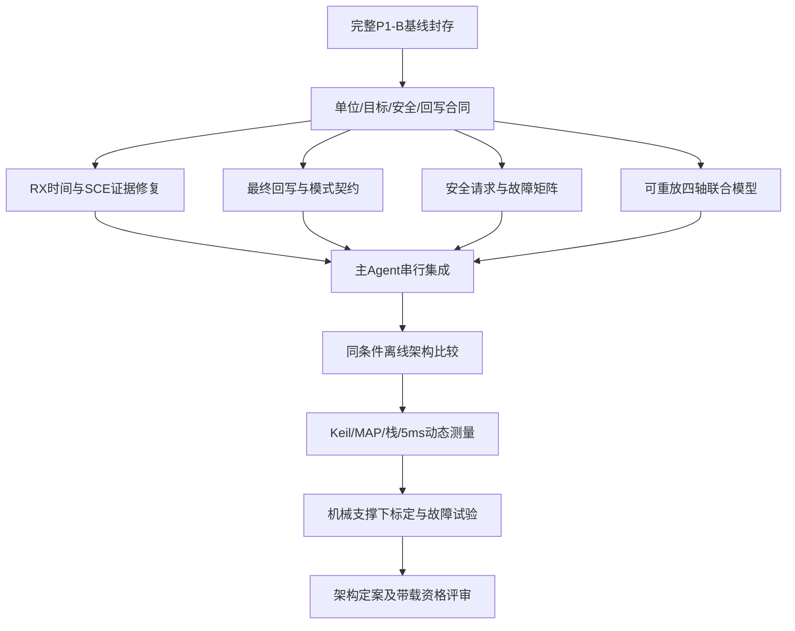

# P2 多 Agent 并行研发准备与实施规划

日期：2026-10-19。工程根：`D:/rm/lift_infantry/lift_infantry`。本文全部相对路径以该目录为根，引用行为本轮源码的一基行号。

**本轮交付仅为规划文档。** 三个真实子 Agent 均完成独立只读审查，主 Agent 复核证据并处理分歧；未修改固件、测试、配置、原报告或已有验证记录，未重新运行构建/测试，未操作硬件。本规划不授予架构切换、提高电流、扩大行程或带载运动资格。

## 1. Git 基线、约束与真实委派状态

### 1.1 当前可确认的基线

| 项目 | 核查结果 |
|---|---|
| 当前分支 / HEAD | `main` / `5f9782a87d21caa6ffd59ef16e876cbc4faafcc7` |
| HEAD标题 | `feat(lift): add staged stair drive debugging and powered pause` |
| 远端配置 | `origin = https://github.com/lujinlong1/lift_infantry.git` |
| P0 / P1-A / P1-B | 源码、报告和验证记录已在磁盘；**仍是未提交工作区，不在上述HEAD内** |
| 本轮开始的 Git 状态 | 29个已修改跟踪文件、30个新增未跟踪文件；暂存区为空，无删除/冲突 |
| 此前“上传git”状态 | 尚未提交、未推送；此前fetch返回curl 28，连接GitHub 443超时。本地origin/main与HEAD相同只说明缓存引用相同，不能证明远端最新状态 |
| P1-B归档核查 | `Tests/Lift/Results/P1B/source-hashes.json` 的39项源码/配置/构建对象哈希全部匹配；这不是所有新增文件已入Git的证明 |
| 本轮完整工作区指纹 | 排除本文及Git忽略文件，对336个跟踪/非忽略新增文件按路径排序，以`路径字节+NUL+文件SHA256字节`累计SHA256：`48097ed25ccde1ba738e943c59b832d4e594abbe247dd37400eacfca81d3b1d4` |

因此，本轮的审查对象是“HEAD + 当前P0～P1-B工作区”，不能把裸HEAD当作完成后的P1-B基线去新建开发分支。**G0必须先固化完整工作区为可复现提交，再创建下一轮开发分支/工作树。** 本轮遵守只创建本文的范围，不继续执行git add/commit/push，也不改写基线来掩盖上传未完成。

### 1.2 AGENTS.md 与角色配置

- 在工程及所查子树，以及`D:/`、`D:/rm/`、`D:/rm/lift_infantry/`父路径未发现适用的`AGENTS.md`。
- 全局`C:/Users/lujinlong/.codex/AGENTS.md`存在但为0字节，没有附加指令。
- 工程根及外层目录均没有`.codex/`；没有截图中的项目级`control.toml`、`safety.toml`、`validation.toml`。
- 全局`.codex/config.toml`中未读取到`agents`角色定义或`features.multi_agent`值；未发现上述三种全局角色文件。没有将截图示例当成真实安装状态，也未按截图自动创建配置。
- **实际委派能力由本会话暴露的collaboration工具确认。** 三个角色通过独立任务提示运行，未依赖不存在的TOML角色文件；本轮没有另外创建用户任务或工作树。

### 1.3 真实并行执行记录

| 子 Agent 任务标识 | 独立范围 | 实际结果 |
|---|---|---|
| `/root/control` | 独立轴/三模态、PID/FF/限幅/轨迹/同步、带载与耦合 | 完成，只读返回C-01～C-06 |
| `/root/safety` | P1-B之后的找零/行程/停机/恢复、架构安全契约 | 完成，只读返回S-01～S-07，并撤回一项未成立疑点 |
| `/root/validation` | 测试覆盖、联合仿真、时序/栈/CAN/VOFA及实机验收 | 完成，只读返回V01～V08 |

首次启动三个任务均曾因用量限制中止，没有有效审查结论；用户要求继续后，主 Agent向这三个真实任务分别重试一次，之后三者均恢复为running，并各自返回完整结论。下文采用成功重试后的成果，不把失败启动当成完成，也没有模拟三个角色的独立输出。

风险等级是项目内的定性优先级，非ASIL/SIL/PL认证：**严重**涉及独立承载/防坠和系统失效；**高**涉及输出、反馈可信性、恢复或架构兼容；**中**涉及覆盖/接口解释等。证据分类严格区分：已确认代码缺陷/接口缺口、理论风险、待实机验证假设。风险等级高不等于现场故障已复现。

## 2. P2 控制架构现状与主要问题

### 2.1 生产路径事实

`Application/Lift/Src/lift_control_task.c:580`，`lift_build_config()`明确设置`axis_control_enabled=true`。`Application/Lift/Src/lift_top.c:638–648`按该开关二选一：

```text
当前：命令/序列四轴目标 → 共同参考规划与同步缩放
     → 每轴位置P → 每轴速度PI + 一份负载前馈
     → 每轴电流/电流斜率/行程约束 → Guard → top故障处理
     → P1-B门禁/收回轴锁零 → 所有权/缓存 → CAN打包 → 带时间的反馈

旧兼容候选：height/roll/pitch目标 → 三模态P/PI与旧规划/预测限幅
           → 三模态分配为四轴电流 → 同一Guard及后续链
```

`Application/Lift/Inc/lift_control.h:4–14`明确：当前轴路径中的height/roll/pitch/warp是诊断变换，没有额外模态电流控制器。**不能把“两套PID同时抢电流”认作当前实现事实。**

| 项目 | 当前独立轴路径 | 旧三模态兼容路径 / P2注意事项 |
|---|---|---|
| 权威目标 | 四轴逻辑ECD；手动模态API在入口转换 | 只读取height/roll/pitch；精确逐轴暂停/PRECHECK不能直接沿用 |
| 几何与单位 | 每轴counts/mm；参考跟踪误差在mm域比较 | 旧正变换是原始逻辑计数加权和，不等于实际角度/姿态 |
| 协调 | 四轴共同进度与参考跟踪跨度缩放 | height/roll/pitch控制电流分配；代数warp=0仅在分配点成立 |
| PID/FF | 位置P、速度PI，逐轴负载FF，默认FF=0 | 旧模态参数/限幅/保持实现不同，不能只改开关进行公平比较 |
| 限制及回写 | 逐轴真实电流窗口、斜率限制、Guard回写 | 旧预测K模型和下游逐轴门禁可能改变分配结果，需专门适配 |
| 机械约束 | 软件参考一致不证明刚体/接触力一致 | 三模态代数也不证明真实受力无内力或防坠 |

### 2.2 当前主要问题与决策

1. **先修证据可信性，再解释带载失败。** 接收时间被解析时间替代（V01）、独立CAN错误IRQ链缺口（V02），会削弱对“反馈新鲜/通信正常”的判断。
2. **先统一目标与最终执行反馈契约。** C-01是切回旧模态时的潜伏兼容缺陷；C-02是生产阶梯调试路径中可达的最终门禁回写缺口。两者的物理冲击后果仍须验证。
3. **带载失败根因尚未确定。** 零FF、积分建立承载、同步冻结、接触/零点/刚度误差、总线时序都应进入假设树；现有模型不能排除机械过约束，也不能证明它存在。
4. **保留当前独立轴实现为对照，不直接恢复旧三模态。** 对照“独立轴+现有共同规划”“明确物理单位的三模态候选”“姿态层+逐轴执行/受约束分配候选”。在同一植物、参数、门禁和通信条件下比较，先离线，不新增在板运行开关。
5. **架构选择依赖接触状态与机构几何。** 四个支承全接触、部分脱开和分组收回的自由度不同；不能未经测量一概认定机构始终是理想三自由度刚体，也不能一概把四位置环当作独立植物。

## 3. 三个 Agent 的独立结论及证据

### 3.1 Control Agent

| ID / 等级 / 分类 | 文件、符号与代码证据 | 触发、边界及下一轮验证 |
|---|---|---|
| **C-01 高：潜伏兼容代码缺陷** | `Application/Lift/Src/lift_control_task.c:748–752,763–766`，`lift_route_sequence()`在exactECD暂停/PRECHECK只填写`axis_target_ecd[]`；`Application/Lift/Src/lift_control.c:950–970`，旧`lift_control_update()`只使用`target_height/roll/pitch`；`Application/Lift/Src/lift_seq.c:1588`标记精确暂停 | **当前axis=true不触发。** 直接启用旧分支会丢失精确暂停或初始姿态，可能沿用旧模态目标。测试相同exactECD配不同旧modal字段、非整毫米/非零warp暂停和PRECHECK不跳变。三模态无法表达的第四分量须明确拒绝/降级契约，禁止静默投影 |
| **C-02 高：已确认执行反馈接口缺口** | `Application/Lift/Src/lift_top.c:673–674`调用`lift_control_track_axes()`回写Guard输出；`Application/Lift/Src/lift_control_task.c:2435–2440`随后把`stair_retracted_mask`轴的`applied=0`，无最终回写；`Application/Lift/Src/lift_control.c:240–242`保留早先电流状态。`Tests/Lift/test_lift_axes.c:973–988`有可达场景 | 在收回轴锁零、Guard原输出非零时，内部斜坡状态与最终提交不同。真实冲击/积分后果未证明。下轮先追加内部状态与本任务已授权提交值的断言，覆盖锁零持续、暂停/恢复和COMPLETE移交；回写必须明确raw/logical和所有者，不能使用异步旧缓存冒充同周期执行 |
| **C-03 高：理论风险** | `Application/Lift/Src/lift_control.c:85–103`，`lift_control_update_axes()`按四轴`reference-position`误差跨度缩放；`:112–126`共同STOP冻结参考速度。`Tests/Lift/test_lift_axes.c:274–278`已有`sync_scale==0`断言 | 一轴慢/卡滞/校准偏差会限制全体参考推进，但PI仍针对冻结参考工作。这是现有协调行为，不是CAN未输出的证据。用一轴高摩擦、变负载及反馈偏差扫参，观测参考、电流和释放条件，不通过放宽同步阈值试错 |
| **C-04 高：待实机假设，软件边界可计算** | `Application/Lift/Src/lift_control_task.c:793`默认FF=0；`:352–356`速度ki=0.5、积分状态限16000、输出限16000；`Algorithms/Pid/Src/pid.c:18–19,29–32`积分限幅；`Application/Lift/Src/lift_control.c:163–177`保持目标速度归零且FF有位置门槛 | 严格零速度误差、默认参数、零FF时I贡献最多8000命令单位。**动态P项仍可出力，不能说总电流上限仅8000。** 若实测静态所需电流超过该值，可能出现微动/退出保持等现象；真实需求未知。先在现有上限内扫负载模型，再机械支撑下测电流—位移/力/温升；不能据此直接加ki/积分限/电流限 |
| **C-05 高：理论风险/待实机假设** | `Application/Lift/Src/lift_control.c:191–211`逐轴PI电流不显式约束warp或分配接触载荷；`Application/Lift/Src/lift_sync.c:95–105`旧分配只叠加三模态 | 刚度/接触高度/零点/摩擦不同可能形成内力；但电流warp不等于实测内力，代数warp=0也不等于物理无内力。模型加入刚体、单向接触柔度、间隙/摩擦与支撑轴掩码；测量后再选择控制/分配方案 |
| **C-06 中：接口单位理论风险** | `Application/Lift/Src/lift_control.c:58–65`手动入口按`cpm[ch]/sum(cpm)`生成轴目标；`Application/Lift/Src/lift_sync.c:50–53`直接对计数加权正变换 | 异构cpm下“物理同高”与“raw模式精确逆变换”不是同一契约。归一化不能仅因不是1/4逆变换判错。下轮明确API权威单位，分别测试物理同高/raw往返/非零roll-pitch/异构cpm；保留旧VOFA含义，新增物理姿态量另行标注 |

Control结论：现有证据不能确定现场带载抬升失败的唯一原因。旧模态预测限幅问题不属于当前正常轴路径，不能拿旧分支行为解释当前失败。

### 3.2 Safety Agent

Safety独立审查没有确认新的默认生产控制链缺陷；以下保留的是明确行为对应的理论风险/物理验证缺口，不重复把P1-B已修复项列为待修。

| ID / 等级 / 分类 | 文件、符号与代码证据 | 风险与下一轮条件 |
|---|---|---|
| **S-01 严重：待实机验证假设** | `Application/Lift/Src/lift_guard.c:198–286`超时下降、`:347–353`FAULT清零；`Devices/RobotMotors/Src/robot_motor_commands.c:347–350`缓存超时打包零；`Application/Lift/Src/lift_top.c:754`，`stop_capable=false` | 禁用/失联/故障/任务停摆的实际电气路径不同，均无非自锁承载或防坠证明。机械支撑下分别测断电、断CAN、电调超时和控制/TX失效；独立制动/防坠是资格前置项 |
| **S-02 高：理论风险，接口前置条件缺口** | `Application/Lift/Src/lift_top.c:414–425`，`clear_rising && state != FAULT`即可清homed/零点；`Application/Lift/Src/lift_control_task.c:2358–2366,2414–2416`撤销标定并归零；`:2635–2640`请求入口 | READY且可能承载时，clear可立即撤销运动资格；不能据此断言必然下坠。先定义clear/rehome的禁用、静止、支撑契约，测试活动手动/序列/同拍clear-start。禁止由Control自行改成未经验证的保持输出 |
| **S-03 高：人工声明语义风险/待实机验证假设** | `Application/Lift/Src/lift_top.c:64–84`，`top_update_contact_homing()`同拍start进入SEEK后即可接受confirmed并记当前位置；`:465–486`后轴minimum人工声明；`:585–586`区分CONTACT/CONFIRMED_MIN。`Application/Lift/Src/lift_control_task.c:1245–1255`已消费确认脉冲 | 误确认或同拍提前确认可能建立错误物理基准；这不是“旧确认位未清”的已确认缺陷。制定找零会话/轴/确认时刻契约并测试早/重复确认、离线和重试；编码器静止不能证明接触、机械最低端或可用行程 |
| **S-04 高：理论风险** | `Application/Lift/Src/lift_seq.c:398–418`，`seq_support_now()`由阶段/released推断支撑；`:438–442`遗留homed/calibrated假设；`:762–778`release改CUT；`Application/Lift/Src/lift_safety.c:124–150`声明支撑选择CUT | 新架构不得将support枚举当成接触/承载传感器。P1-B top和门禁仍有效，但不证明载荷已转移。需要机械支撑下的载荷转移/错误确认验收，独立支撑证据方案另行设计 |
| **S-05 高：理论风险/待实机验证假设** | `Application/Lift/Src/lift_seq.c:1430–1448`测试堵转进入TEST_PAUSED；`:1367–1400`暂停继续位置控制并检查偏差/电流；`:1588`使用exactECD；`Application/Lift/Src/lift_control_task.c:1443–1444`只发布温度 | Powered pause是调试状态，不是已验证停机；仍可能发热。先测试暂停/恢复/下降/abort/离线交错及积分/目标状态，再在支撑下测温升和持续时间。不能擅自新增自动CUT或提高阈值 |
| **S-06 高：受控台架理论风险** | `Diagnostics/MotorTest/Src/lift_jog_task.c:983–989`override后直写缓存，`:1278–1287`已遵守fault inhibit；`Devices/RobotMotors/Src/robot_motor_commands.c:254–275`测试覆写；`:74–77`已有故障旧缓存拦截 | 无故障时台架仍可独立于正常找零/行程/规划运行，这是现有诊断能力。新架构正常运动不能借用台架绕过P1-B。下轮定义台架资格和交接条件，保留故障禁入/所有权短事务；硬件试验必须隔离与支撑 |
| **S-07 严重：已确认系统能力缺口，物理后果待验证** | `Src/freertos.c:73–94`overflow/malloc hook无动作；`Inc/FreeRTOSConfig.h:77,79`已开启hook；`Inc/stm32f4xx_hal_conf.h:58,72`未启用IWDG/WWDG；TX超时反应依赖任务继续运行 | CPU/调度器/TX失效时同一软件不能保证继续清零/记录。**加看门狗复位不自动等于安全**，复位同样可能失去支撑。先由机械/系统安全设计独立失效反应，再定义软件hook/监护策略 |

### 3.3 Validation Agent

本轮只读核验既有日志与源码，**未重跑19套测试、7项编译或Keil**。P0曾有16套测试，P1-A/P1-B增至19套；已有通过记录不覆盖新增审查发现。

| ID / 等级 / 分类 | 文件、符号与代码证据 | 缺口及可验收条件 |
|---|---|---|
| **V01 高：已确认时间语义缺陷** | `Services/Can/Inc/can_rx_service.h:14–20`，`can_rx_frame_t`无接收时间；`Bsp/Src/bsp_can.c:203–205`入队；`Devices/RobotMotors/Src/robot_motors.c:44`出队解析取当前tick；`Devices/DjiMotor/Src/dji_motor.c:156,174`据此更新时间/判在线 | 队列积压后旧帧可获得新更新时间，feedback_age主要反映解析年龄。下轮传递接收/入队时间和队列驻留；注入超过既有100ms阈值的排队，旧帧解析不得伪装新反馈，覆盖tick回绕。现场是否实际积压未测 |
| **V02 高：已确认独立错误IRQ接线缺口** | `Bsp/Src/bsp_can.c:10–14,93–120`请求ERROR/BUSOFF/LEC并有回调；`Src/can.c:125–126,156–157`只启用RX0；`Src/stm32f4xx_it.c:220,332`为RX0处理；现MAP`:7853,7856`两条SCE仍是startup弱默认`0x0800028b` | 无后续RX0时独立错误事件可能不更新回调，**不是所有错误都丢失，也不是现有离线保护不存在**。下轮同时落实SCE向量、处理器、NVIC/优先级及HAL清标志路径，禁止只打开默认弱向量。`Src/can.c:48,50,80,82`自动bus-off恢复/重发均关闭，保持不变，不顺手启用 |
| **V03 高：模型覆盖缺口/物理假设** | `Tests/Lift/test_lift_axes.c:288–324`，带载植物逐轴`v += .005/.06*(.5*(out-weight)-v)`；`:338,345`反向参考试验将位置赋为reference | 四轴独立一阶模型无非对角耦合、静摩擦、间隙、接触、通信延迟或电压动力学；参考反转测试只证明参考性质。新增耦合模型、相同条件A/B；假设参数不能当成标定证据 |
| **V04 高：联合执行链覆盖缺口** | `Tests/Lift/test_lift_system.c:110–147`旧植物含每拍3000计数截断；`Tests/Lift/run_tests.ps1:60`该suite不链接生产task/top/seq；`Tests/Lift/test_lift_axes.c:25–39`桩化反馈/缓存/TX | 分别测过控制、缓存和打包，不等于测试了真实控制→缓存→2msTX→延迟RX队列的完整时序。建立可重放虚拟时钟联合链，覆盖5ms/2ms/100ms边界、延迟/丢失/恢复 |
| **V05 高：理论实时性风险** | `Application/Lift/Src/lift_control_task.c:25,2504–2506`为5ms；`Diagnostics/RuntimeMonitor/Src/runtime_monitor.c:10,45–46`每500ms调用系统快照；`Middlewares/Third_Party/FreeRTOS/Source/tasks.c:2509–2569,3782,3803–3807`挂起调度并扫描栈；`Application/Lift/Inc/lift_lock.h:11,16`PRIMASK事务 | 低优先级监控也可能延迟控制任务释放；尚无超期测量。测量必须覆盖预期释放→实际开始→缓存→发布/完成，而非只测函数入口出口；计入监控采样、IRQ/FPU、短锁和故障复制 |
| **V06 高：已确认故障反应能力缺口+动态栈风险** | `Src/freertos.c:73–94`空hook；`Tests/Lift/Results/P1B/memory-stack.txt:19–25`，link/启动/Idle预留后分别12/184/184B；`:16,33`lift8192/4296B、MSP1024B | 静态通过不证明动态栈安全，更不证明发生溢出后处理充分。保存全部任务最低水位、启动任务退出前水位、MSP和FPU/IRQ嵌套。响应策略由Safety/系统设计批准，Validation不能用自动复位或保持代替 |
| **V07 中：CAN/RX/展开测试缺口** | `Tests/Lift/test_lift_transport.c:17–21`桩替服务发送；`Tests/Lift/run_tests.ps1:51`未链接真实BSP/RX服务/robot_motors；`Services/Can/Src/can_rx_service.c:24,142–159`128槽及丢弃；`Devices/DjiMotor/Src/dji_motor.c:96–122`半圈展开 | 现有缓存/打包/BUSY/ERROR/过期测试有效，但不覆盖真实ACK、仲裁、邮箱完成、bus-off、RX队列满、反馈展开。新增原始帧回放、±4096边界、长间隔/丢帧和队列恢复；反馈不能作为逐命令ACK |
| **V08 中：待实机验证与协议约束** | `Tests/Lift/test_lift_telemetry.c:47–87`覆盖忙/TC、源布局、200帧和恢复；`:24–36`人为改变HAL状态 | 现有DMA不覆盖在途帧的软件测试充分，但未证明真实IRQ生命周期。保留USART1/115200/8N1/JustFloat；116B线时约10.07ms，占20ms约50.35%，忙丢帧不等于帧损坏。实测源切换、延迟TC、DMA错误、36/116B边界；超过2^24的ID用整数证据对齐 |

补充：P1-B负向用例已在`Tests/Lift/test_lift_axes.c:1314–1489`覆盖复位、无效状态、标定/布局/200mm拒绝和故障输出。不能因正向夹具显式确认标定而称所有测试绕过门禁。`Tests/Lift/test_lift_properties.c:345`随机性质调用旧模态API，需为生产独立轴另建随机覆盖，保留原用例。

## 4. 主 Agent 交叉复核与分歧裁决

| 问题 | 裁决与证据 | 规划影响 |
|---|---|---|
| “两套控制器同时争电流” | 不成立；task固定轴路径、top分支互斥（task:580、top:638–648） | 不以删除“额外模态PID”作为修复任务 |
| “异构cpm不构成严格模态逆变换，所以公式错误” | 不足以判错；物理毫米语义与raw计数语义不同（C-06） | 先统一单位与目标合同，再决定实现 |
| “Guard下降分支跳过普通软限位，必然可越界” | **撤回。** Safety初稿遗漏`lift_guard_init():111–123`的停车点夹取。负向运动在`position<=min<=target`时reached为真；正向对上界同理（`:210–217`）。即便上下界倒置，初始化规范化后未找到合法入口反例 | 不列为已确认代码缺陷，不计划无证据改变Guard输出；补初始化/方向/目标判定性质测试。绕过初始化直接改内部配置仍属可信边界风险 |
| “静止积分最多8000，所以16000上限无效/负载一定举不动” | 前半是默认参数下I贡献的可计算上界；后半不成立，动态P/FF及真实载荷未知（C-04） | 先模型和测量，不直接调大电流/积分/ki |
| 收回轴门禁后未回写 | 主Agent复核top:673–674与task:2435–2440，确认接口缺口（C-02） | 先补同周期授权提交回写复现；物理瞬态影响另测 |
| RX时间戳与SCE事件链 | 主Agent核对结构、解析、NVIC、handler及实际MAP，支持V01/V02的代码结论 | 列为架构改造前的通信证据修复，不能据此声称已经复现现场失联 |
| “静态栈脚本/19套测试通过就证明5ms和物理承载” | 不成立；已有结果为软件/静态证据，监控扫描与真实植物未覆盖 | 动态时序与机械资格单独设关卡，不重写P0～P1-B历史报告 |

**确认的代码/接口问题优先集**：V01、V02、C-02；C-01是旧模态重新启用前必须解决的潜伏兼容问题。S-07/V06是同一系统能力缺口，合并处理，不能算成两个独立故障。C-05/V03是同一机械耦合验证需求，模型与实测双向约束。

## 5. P2 任务依赖、优先级与预计文件

下列均为**下一轮候选变更**，本轮没有实施。优先级P2-A/B/C是本计划内部顺序，不是承诺已修改。

| 任务 | 顺序 / 依赖 | 交付及预计修改文件 | 退出条件 |
|---|---|---|---|
| T0 基线封存与可重现性 | 第一；所有开发依赖 | 封存当前源码/新增文件/三报告及结果；下一轮经授权提交并核对远端；固定源码/ELF/MAP/参数清单 | 新分支从完整P1-B提交创建，原19套+7编译、Keil6.21、17任务预算可复现；不是只从当前旧HEAD开工 |
| T1 单位/命令/安全/回写合同及失败用例 | P2-A；依赖T0 | 先新增`Tests/Lift/test_lift_p2_contracts.c`等；接口预期涉及`lift_control.h`、`lift_top.h`，最终提交由主Agent适配`lift_control_task.[ch]` | exactECD/模式优先级、未表示自由度、raw/logical、dt、参数版本、门禁/所有者和回写定义达成；新失败用例可定位C-01/C-02，旧测试不删 |
| T2 接收时间戳贯通（V01） | P2-A；T0/T1后，可与T3/T4并行设计 | `Services/Can/Inc/can_rx_service.h`、RX服务、`Bsp/Src/bsp_can.c`、`Devices/RobotMotors/Src/robot_motors.c`、`Devices/DjiMotor/*`及新回放测试 | 超100ms驻留的旧帧不能因晚解析恢复新鲜度；区分接收/解析/队列年龄；回绕/队列满/恢复通过；重查128槽结构增长RAM |
| T3 SCE中断/事件通路（V02） | P2-A；T0后，串行集成通信热点 | `Src/can.c`、`Src/stm32f4xx_it.[ch]`、BSP错误路径及必要诊断适配 | CAN1/2真实SCE handler与NVIC同时成立，优先级满足现有RTOS约束；寄存器/HAL桩验证并保留待硬件bus-off测试；不自动开启ABOM/重发 |
| T4 最终提交反馈与模式兼容（C-02/C-01） | P2-A；T1先定合同 | 算法侧`lift_control.[ch]`；主Agent集成`lift_top.[ch]`/`lift_control_task.[ch]`及新契约测试 | Guard后锁零/门禁/失去所有权不遗留错误斜坡状态；不回写别的所有者旧缓存；旧模态未通过exactECD合同前不得启用 |
| T5 安全请求/声明契约与故障矩阵 | P2-A/B；T1；与T2/T4交叉评审 | `lift_top.[ch]`、`lift_safety.[ch]`、`lift_seq.[ch]`、必要的`lift_homing.[ch]`及独立安全用例 | 定义clear/rehome/早确认/同拍恢复等允许、拒绝、锁存；维持P1-B所有门禁、失效锁存、100ms缓存归零；不擅自增加保持/下降策略 |
| T6 可重放四轴联合植物与证据链 | P2-B；T1后可先做模型，依赖T2/T3/T4接口集成 | 新`Tests/Lift/p2/`模型/调度/录制回放，独立suite；主Agent注册`Tests/Lift/run_tests.ps1` | 同一时间线运行5/2/20ms任务与RX队列；固定seed/初值/参数/事件，失败可单case重放，标明假设与实测参数 |
| T7 控制候选离线比较 | P2-B；T5/T6门禁与模型先行 | Control负责`lift_control.[ch]`、`lift_sync.[ch]`或新隔离候选模块；先不接生产开关 | 相同植物/参数/限幅/门禁对照，逐项报告跟踪/姿态/内力代理/饱和/电流指标；不能只比较调得不等价的旧新参数 |
| T8 资源/实时性测量及无危险运动验证 | P2-B；每次集成都做，候选上板前必须通过 | 独立测量分支中必要计时；`Diagnostics/RuntimeMonitor/*`、RTOS/Keil配置仅主Agent集成；Validation脚本 | MAP、DMA和静态预留通过；测预期释放到完成的5ms截止时间，监控500ms扫描/首次故障/IRQ/FPU/短锁组合；保存动态水位 |
| T9 逐轴标定与机械支撑故障验收 | P2-C；T2～T8软件关卡、机械试验许可 | 测量记录/参数档案/原始CAN及P0数据；工程参数修改另行审批 | 测真实方向、零点类型、位移—计数、剩余行程/干涉/余量；逐轴失联及CPU/TX/电调失效留证，不用历史200mm推定 |
| T10 架构定案及受控带载资格 | 最后；T9与机械独立安全证据 | 架构决策、参数依据和载荷/热/制动验收报告 | 机械承载/防坠/独立失效反应与动态边界均获批准，才安排受控载荷；本规划不预先批准 |



## 6. 下一轮并行开发的文件所有权

**每个文件只有一个写入所有者。** 其他Agent提供接口/补丁提案或审查意见，不同时编辑该文件；不以“各改不同函数”回避共享头文件/集成冲突。下表为推荐分配，下一轮任务下发时冻结。

| 所有者 | 独占写入候选范围 | 交付接口 / 禁区 |
|---|---|---|
| Control | `Application/Lift/Inc/lift_control.h`、`Src/lift_control.c`；必要的`lift_sync.[ch]`；新隔离候选模块 | 输入输出/dt/单位/饱和状态合同；不写homed、datum、布局/行程确认、fault/recovery、所有权或CAN缓存；通用`Algorithms/Pid`默认冻结，变更须独立论证其他调用者 |
| Safety | `lift_top.[ch]`、`lift_guard.[ch]`、`lift_safety.[ch]`、`lift_seq.[ch]`；必要找零模块 | 安全事件判定表、无隐式恢复；整个seq文件由Safety单写，包括Control提出的路由需求；不擅改正常运动算法或物理停机策略 |
| Validation | 新增`Tests/Lift/p2/`、新增独立suite/模型/回放和测量解析；未来独立P2结果目录 | 固定seed/参数/事件、判定器和失败重放；不修改固件输出路径；避免同时改现有大文件`Tests/Lift/test_lift_axes.c` |
| 主 Agent / 集成所有者 | `lift_control_task.[ch]`、`lift_diagnostics.[ch]`、`robot_motor_commands.[ch]`、既有`Tests/Lift/test_lift_axes.c`、`Tests/Lift/run_tests.ps1`/`Tests/Lift/compile_check.ps1`、Keil/FreeRTOS/中断配置、RuntimeMonitor | 处理C-02最终提交适配、模式路由、诊断兼容、统一注册与资源审计；top接口由Safety先提交后主Agent审查，Control不并写 |
| 主 Agent / 通信串行子任务 | `Services/Can/*`、`Bsp/*bsp_can*`、`robot_motors.[ch]`、`dji_motor.[ch]`、`Src/can.c`、`stm32f4xx_it.[ch]` | 统一处理V01/V02，不让多个Agent分头改同一帧结构/ISR；Validation提供独立测试，Safety审核超时/恢复契约 |

Control/Safety若需要测试修改，将用例要求提交Validation。确有必要由专业Agent实现专用测试时，主Agent先划出互不重叠的新文件名；现有脚本注册和既有大测试文件仍由集成人单写。

本轮不建立工作树。下一轮若需要隔离并行开发，应在T0封存提交之后再按用户任务创建分支/工作树，所有角色使用同一基线及依赖提交；不能从未包含P1-B的旧HEAD创建后悄悄补入局部改动。

### 跨角色不可破坏的合同

1. **目标**：四轴逻辑ECD/校准mm、模态量的单位与优先级明确；精确暂停和PRECHECK不制造零目标或丢弃第四分量。无法表示时的拒绝行为必须由Safety定义。
2. **执行反馈**：至少区分控制需求、Guard输出、本任务已授权的最终缓存提交和异步TX/反馈。raw转logical只按当轴方向；本周期未运行控制器、未授权或未写缓存不得冒充本周期执行。HAL接受与电机反馈均不是逐命令ACK。
3. **资格**：新控制器只消费Safety资格，不写其状态“帮助启动”。真实找零、datum、行程/布局、离线/故障锁存、恢复条件和测试禁入原有语义必须保持。
4. **限幅**：不提高现有电流上限、不缩减既有软限位余量、不取消100ms缓存归零，不通过取消同步/保护让模型通过；任何物理参数变化要有测量依据。
5. **通信**：接收时间/解析时间/队列驻留与控制周期分别标记；命令缓存和TX维持P1-A原子事务；不改原source=0/1/2/3通道语义。
6. **诊断**：P0快照继续单写发布、有界读取；黑匣子在历史未满、任务停摆或掉电时不伪造2秒/post数据；新增字段需重查尺寸/MAP/快照测试，不能把诊断字段用于控制授权。

## 7. 每阶段的软件验证与实机验收

### G0：可重现基线

- 完整保留59项既有工作区变更及三阶段报告/证据，排除临时文件/构建产物后封存提交；远端状态单独核对。此前39项哈希通过只是局部归档验证。
- 下一轮建立同版源码/参数、测试、Keil6.21 AXF/MAP/调用图/日志哈希。原19组可执行测试+7项严格编译、全量构建0错误0警告和17任务预算均须通过。
- 本轮只读取原通过记录，没有把该门槛标成“本轮已重跑”。

### G1：先固定证据和接口

- V01：用真实接收时间而非新解析时刻判断年龄；在100ms前/等于/后、32位回绕、队列128槽满/排空、乱序策略和持续旧帧回放下验证，不通过延长阈值“修复”。 若仅在ISR读取FIFO/入队时取时戳，应明确标为软件接收时刻；它仍包含硬件FIFO驻留和IRQ延迟，不能冒充电机采样时刻或精确线上到达时刻，相关延迟须在G3/G4测量。
- V02：SCE处理器、向量、NVIC和HAL回调/清标志路径一同测试；不能只开弱默认IRQ。保留现有自动恢复/重发配置，错误事件只加强证据，不擅自触发危险自动恢复。
- C-02：逐轴检查Guard后门禁、锁零、所有权失败、暂停/恢复、COMPLETE移交，验证内部斜坡/积分跟踪与合同定义的一致提交值；失去通道不得错误回写别的所有者。
- C-01：同exactECD不同旧modal字段、非零warp、非整mm暂停、不同初始姿态及异构cpm。未通过前，不启用新/旧模态在板路径。
- S-02/S-03：clear/rehome/早确认/重复确认/同拍clear-start/reset-start/离线中恢复均有明确允许或拒绝断言；软件测试证明资格与输出契约，不证明物理支撑。

### G2：联合仿真和软件故障矩阵

- 单一虚拟时钟驱动生产控制5ms、TX2ms、诊断/遥测20ms和异步反馈；植物步长更细时记录数值收敛性，不能用“位置立即贴合reference”替代动态植物。
- 层级M0保留原独立一阶模型作为回归；M1加入重力/惯性/阻尼/静摩擦/量化/电压和电流动态；M2加入车体高度/横滚/俯仰、第四支承柔度、单向接触脱开、间隙和分组收回。所有未测质量/摩擦/刚度/行程参数标“假设”，不从历史暂定值变成实测。
- 四轴逐一覆盖不均负载、慢轴/卡滞、反馈冻结/延迟/丢帧、比例/零点偏差、软边界、命令超时、控制/TX挂起、通道竞争、非法状态、缺失复位条件及运动中撤销布局/标定；覆盖升/保持/降/阶段切换。
- 记录目标/参考/位置/速度、PID/FF/各级电流、sync_scale、所有者/提交、包字节、接收/解析年龄和故障周期；固定seed/初值/参数/事件/固件版本，单case可重放。
- A/B比较使用相同限流/斜率/目标/门禁/植物；报告跟踪/姿态、warp电流、接触力/内力代理、饱和占空、峰值与累计电流及滞后。代理量不是实际力/热认证；物理合格阈值待测量和批准。

### G3：目标资源和5ms测量

既有P1-B资源仅为参考基准：RW+ZI **173456 B**，普通SRAM使用119496/131072 B、CCM使用53960/65536 B，合计未分配23152 B；黑匣子61176 B、目标帧588 B。lift栈8192 B、Keil静态深度4296 B，另留1024后2872 B；link/启动/Idle已有窄余量，不能忽视。

- 每次结构/队列/模块增长都重跑MAP/17任务脚本及Keil全量构建。128槽RX新增时间字段的RAM按实际结构对齐计入，不能仅按单个uint32估算后不看MAP。DMA缓冲必须仍处于可访问普通SRAM。
- 沿用现有静态筛查预留：lift1024 B、Idle256 B、其他512 B；不降低预留让脚本通过。运行时另保存所有任务最低水位、启动任务退出前水位、MSP及FPU/IRQ嵌套；动态合格裕量须团队批准。
- 在机械支撑/无危险运动条件下，以GPIO+逻辑分析/DWT，测**预期释放→实际开始、开始→缓存、开始→诊断发布、预期释放→完成**。本规划按现有5ms周期提出“释放至完成不超过一个周期”的下一轮验收目标；这是待验证的工程目标，不是已测结果或机械安全反应时间。额外裕量及更严格截止由团队批准。
- 覆盖500ms监控系统快照扫描、20ms历史记录、首次故障before/trigger/post、rearm、参数请求、CAN/RX突发、UART/DMA/USB并发与PRIMASK/FPU组合。仅函数内部WCET或低优先级监控平均耗时不足以证明调度满足。
- 任一超期/栈裕量不足/快照持续失败都先定位和重新评审；不擅自改变控制周期、提高优先级或关闭监护当作完成。

### G4：有独立机械支撑的实机验收

- 由验证合格的支撑/制动/防坠设施承担危险载荷，车轮与人员隔离；先核对ID、原始/逻辑方向、每轴真实参考类型、位移—计数、剩余有效行程/干涉/回差和余量。不得由150000/750/200mm或已删除临时补偿推定当前物理跨度。
- 先受限小位移、无危险载荷，再进行准许的耦合验证。P0全链路、CAN分析仪、DWT/GPIO、独立位移/载荷/温度测量对齐保存；不能仅靠反馈电流或CAN接受判断电机执行。
- 分别注入每轴断反馈/断CAN、bus-off、控制/TX挂起、掉电/MCU复位、错误/提前确认、持续遥控请求及恢复；核对原有软件时间阈值和资格锁存，不以“反馈恢复”自动恢复危险运动。
- clear、重新找零、复位、布局/行程确认和台架交接均在物理支撑成立时验证；HOLD/LOWER/TEST_PAUSED、低位窗口和零电流不构成独立安全措施。
- 物理承载、温升、制动/下坠距离和姿态合格限由机械/系统安全设计批准，本规划不杜撰数值。

### G5：架构定案与带载资格

仅在真实行程、几何/接触、支持能力、独立制动/防坠、失电/失联/CPU失效反应及恢复/热/动态限值均有批准证据后，才安排受控带载试验。仿真收敛、19套软件回归、Keil通过、持续通电和三模态代数warp=0均不能替代该资格。

## 8. 推荐实施顺序与本轮结束状态

推荐顺序：**G0封存基线 → T1合同与失败复现 → 优先修V01/V02/C-02并锁定C-01兼容 → 并行完善安全契约与联合模型 → 同条件离线架构比较 → Keil/MAP/栈/5ms动态测量 → 机械支撑下标定和故障矩阵 → 架构定案与带载资格评审。**

下一轮可并行开展：Control的纯算法/契约方案、Safety的事件/资格判定与安全用例要求、Validation的新模型/失败重放；通信/公共结构/任务路由/工程配置由主Agent串行集成。不要让三个角色共同编辑`Application/Lift/Src/lift_control_task.c`、`Tests/Lift/test_lift_axes.c`或同一公共头文件。

本轮三份独立只读结论和交叉裁决已完成；唯一新增交付为本文。P0/P1-A/P1-B的源码、测试、配置、报告、验证记录及现有构建对象保持原样。Git提交/上传、实现修复、模型新增、重新构建和硬件验证均是下一轮事项，等待后续开发任务。

## 9. 本轮交付范围核验

完成文档后重新计算第1节的336文件工作区指纹，与本轮开始完全一致；39项P1-B归档哈希也全部匹配。HEAD与暂存区未变。仅新增`LIFT_MULTI_AGENT_PLAN.md`，没有新增其他结果/脚本/配置，没有改动原有源码、报告、记录或构建对象。引用的源码路径和首行行号已做存在性检查。三位子Agent均真实返回completed。上述是只读范围/引用核验，不是新一轮控制测试或硬件验证。
